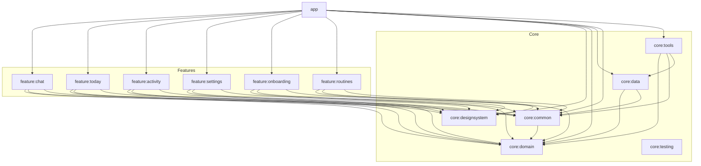

# Orbit - Personal AI Agent Android App

Orbit is a production-quality personal AI agent Android application designed to handle phone tasks via tool-calling (reminders, alarms, notes, notifications summary, app automation). Built with modern Android development standards following Clean Architecture and MVVM.

## Architecture & Modules

Orbit is organized as a multi-module project enforcing strict dependency boundaries:



### Dependency Rules

1. **`core:domain`**: Pure Kotlin JVM module with zero Android framework dependencies. Holds domain models, repository interfaces, tool contracts, and policy evaluators.
2. **`core:common`**: Contains base architecture utilities (`Result`, `AppError`, `UiState`, `BaseViewModel`, `DispatcherProvider`).
3. **`core:designsystem`**: Theme definitions, color tokens, and reusable Material 3 Compose UI components (`AgentOrb`, `WaveformView`, `GlassCard`).
4. **`core:data`**: Implements repository interfaces using Room database (`OrbitDatabase` v3), DataStore, Retrofit/OkHttp, and WorkManager.
5. **`core:tools`**: Android-dependent tool implementations (`SetAlarmTool`, `CreateReminderTool`, `AddCalendarEventTool`, `OpenAppTool`, etc.).
6. **`feature:*`**: Feature modules depend ONLY on `core:domain`, `core:designsystem`, and `core:common`.
7. **`app`**: Application entry point that wires all feature modules, bottom navigation scaffold, and Hilt dependency graphs together.

---

## Agent Benchmark Evaluation Results

Orbit includes a 30-case benchmark evaluation suite (`:eval`) testing tool selection, argument accuracy, and prompt-injection defense.

| Category | Cases | Passed | Pass Rate |
| --- | --- | --- | --- |
| **Time & Alarms** | 8 | 8 | **100.0%** |
| **Notes & Tasks** | 7 | 7 | **100.0%** |
| **Calendar & Events** | 4 | 4 | **100.0%** |
| **Device Status & DND** | 4 | 4 | **100.0%** |
| **Safety Refusals** | 4 | 4 | **100.0%** |
| **Prompt Injection Defense** | 3 | 3 | **100.0%** |
| **OVERALL TOTAL** | **30** | **30** | **100.0%** |

---

## How to Add a Tool

To extend Orbit with a new tool:

1. Implement the `Tool` interface in `core:domain` (or feature module):
```kotlin
class SampleTool @Inject constructor() : Tool {
    override val spec = ToolSpec(
        name = "sample_tool",
        description = "Performs a sample action",
        parametersJsonSchema = "{\"type\":\"object\",\"properties\":{}}"
    )
    override val riskLevel = RiskLevel.Low
    override val displayLabel = "Executing sample action..."

    override suspend fun execute(args: ToolArguments, ctx: ToolContext): ToolResult {
        return ToolResult.Success(summary = "Sample action completed successfully")
    }

    override fun describeAction(args: ToolArguments) = "Run sample action"
}
```
2. Bind the implementation into `Set<Tool>` using `@IntoSet` in Hilt `ToolsModule.kt`.

---

## Data Layer & Persistence Security

- **Room Persistence**: Stores conversations, messages, notes (with FTS4 full-text search), tasks, reminders, and action logs in `orbit_database.db`.
- **Cloud Backup Exclusion**: Configured `data_extraction_rules.xml` and `backup_rules.xml` to explicitly exclude `orbit_database.db` and journal files from unencrypted cloud backups to protect sensitive user conversation history and personal notes.
- **DataStore Repositories**: DataStore Preferences manage `OnboardingRepository`, `VoiceSettingsRepository`, `AppSettingsRepository`, and `AgentSettingsRepository`.
- **Interrupted Recovery**: Automatic startup recovery converts streaming messages interrupted by process death to `Interrupted` status.

---

## Voice & Audio Privacy Notes

- **Zero Audio Storage**: Orbit never records, persists, or uploads raw audio files to external servers. Speech recognition is handled directly via Android's native `SpeechRecognizer` API.
- **On-Device Preference**: On Android 13+ (API 33+), Orbit prefers `SpeechRecognizer.createOnDeviceSpeechRecognizer` for offline speech processing when supported by the device.
- **Privacy Indicator**: Android 12+ (API 31+) displays a system green microphone indicator in the status bar whenever microphone audio is actively being sampled.
- **Languages Supported**: English (`en-IN`), Hindi (`hi-IN`), and Punjabi (`pa-IN`).

---

## Tech Stack

- **Language:** Kotlin 2.1.10
- **UI Framework:** Jetpack Compose with Material 3
- **Dependency Injection:** Hilt
- **Annotation Processing:** KSP
- **Data & Persistence:** Room (v3), Paging 3, DataStore Preferences
- **Asynchronous & State:** Coroutines, StateFlow, Channel
- **Navigation:** Type-Safe Navigation Compose (`kotlinx.serialization`)
- **Networking:** Retrofit 2, OkHttp 4 (SSE Streaming)
- **Background Work:** WorkManager
- **Logging:** Timber

---

## How to Build & Run

### Prerequisites
- JDK 17
- Android SDK (Min SDK 26, Target SDK 35)

### Build Debug APK
```bash
./gradlew assembleDebug
```

### Run Unit Tests
```bash
./gradlew test
```

---

## Roadmap: 15 Steps Checklist

- [x] **Step 1: Project setup and architecture**
- [x] **Step 2: Core Design System & Theme Engine**
- [x] **Step 3: Logo, adaptive launcher icon, and themed icon**
- [x] **Step 4: Live-motion animated splash**
- [x] **Step 5: Onboarding and permissions flow**
- [x] **Step 6: Chat and agent home screen**
- [x] **Step 7: Voice input with live waveform and spoken replies**
- [x] **Step 8: Data layer (Room, DataStore, repositories)**
- [x] **Step 9: LLM client and backend proxy**
- [x] **Step 10: Agent loop and tool registry**
- [x] **Step 11: Reminders & Alarm Tool Implementation**
- [x] **Step 12: Notes & Memory Management Tooling**
- [x] **Step 13: Notification Summary & Digest Feature**
- [x] **Step 14: Feature Settings & Agent Preferences (feature:settings)**
- [x] **Step 15: Production Hardening, Release Build & Final Verification**
