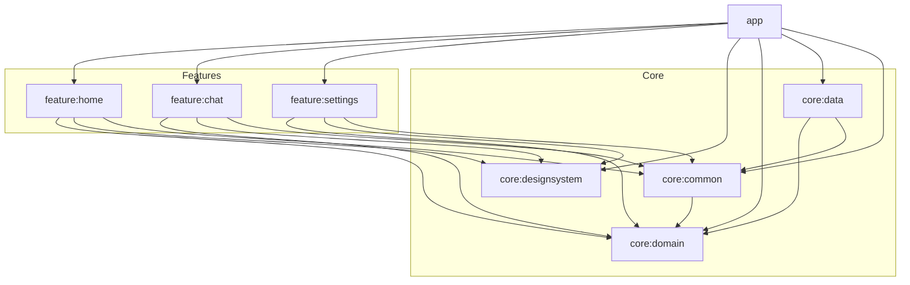

# Orbit - Personal AI Agent Android App

Orbit is a production-quality personal AI agent Android application designed to handle phone tasks via tool-calling (reminders, alarms, notes, notifications summary, app automation). Built with modern Android development standards following Clean Architecture and MVVM.

## Architecture & Modules

Orbit is organized as a multi-module project enforcing strict dependency boundaries:



### Dependency Rules

1. **`core:domain`**: Pure Kotlin module with zero Android framework dependencies. Holds domain models, repository interfaces, and use cases.
2. **`core:common`**: Contains base architecture utilities (`Result`, `AppError`, `UiState`, `BaseViewModel`, `DispatcherProvider`).
3. **`core:designsystem`**: Theme definitions, color tokens, and reusable Material 3 Compose UI components.
4. **`core:data`**: Implements repository interfaces using Room database, DataStore, Retrofit/OkHttp, and WorkManager.
5. **`feature:*`**: Each feature module depends ONLY on `core:domain`, `core:designsystem`, and `core:common`. Feature-to-feature dependencies are strictly forbidden.
6. **`app`**: Application entry point that wires all feature modules and Hilt dependency graphs together.

---

## Brand & Logo Guidelines

The Orbit brand mark consists of a glowing tilted orbit ring surrounding a gradient core sphere with a revolving satellite dot.

### Master Geometry Specification
- **ViewBox**: 108 x 108
- **Core Sphere**: Center `(54, 54)`, Radius `16dp`, Gradient `Electric Violet (#7C5CFF)` to `Cyan (#22D3EE)`
- **Orbit Ring**: Center `(54, 54)`, Radius X `28dp`, Radius Y `12dp`, Tilt `-25°`, Gradient stroke with fade end
- **Satellite Dot**: Orbiting point at radius `(28dp, 12dp)`

### Brand Assets
- **Adaptive Launcher Icon**: `app/src/main/res/drawable/ic_launcher_foreground.xml` inside central 66dp safe zone with `ic_launcher_background.xml` deep navy gradient.
- **Themed Icon (Android 13+)**: `app/src/main/res/drawable/ic_launcher_monochrome.xml` flat single-color silhouette.
- **Notification Icon**: `app/src/main/res/drawable/ic_stat_orbit.xml` 24dp flat white glyph with transparency.
- **In-App Composable**: `OrbitLogo(size, mode, animated)` in `core:designsystem` supporting `Mark`, `Wordmark`, and `Mono` modes with satellite animation.

### Rules & Usage
- **Clear Space**: Minimum padding equal to `size * 0.25` around the mark.
- **Minimum Size**: `24dp` in-app; never scale below 24dp to maintain ring & satellite legibility.
- **Prohibited**: Do not stretch, alter gradient angles, add unapproved drop shadows, or recolor outside brand palette tokens (`#7C5CFF`, `#22D3EE`, `#070B1A`).

### Google Play Store Asset Export Instructions
To produce the 512x512px Play Store app icon:
1. Open Android Studio -> Right-click `app/src/main` -> **New > Image Asset**.
2. Select **Asset Type: Vector Asset** and choose `ic_orbit_logo.xml`.
3. Set Target Size to `512 x 512 px` and Export as PNG to output `play_store_512.png`.
4. Feature Graphic (`1024 x 500 px`): Render `ic_orbit_logo.xml` centered at 256x256px over an aurora background fill (`#070B1A` to `#1E1B4B`).

---

## Tech Stack

- **Language:** Kotlin 2.1.10
- **UI Framework:** Jetpack Compose with Material 3
- **Dependency Injection:** Hilt
- **Annotation Processing:** KSP
- **Asynchronous & State:** Coroutines, StateFlow, Channel
- **Navigation:** Type-Safe Navigation Compose (`kotlinx.serialization`)
- **Data & Persistence:** Room, DataStore Preferences
- **Networking:** Retrofit 2, OkHttp 4
- **Background Work:** WorkManager
- **Logging:** Timber

---

## How to Build & Run

### Prerequisites
- JDK 17
- Android SDK (Min SDK 26, Target SDK 35)

### Build Debug APK
```bash
./gradlew assembleDebug
```

### Run Unit Tests
```bash
./gradlew test
```

---

## Roadmap: 15 Steps Checklist

- [x] **Step 1: Project setup and architecture**
- [x] **Step 2: Core Design System & Theme Engine**
- [x] **Step 3: Logo, adaptive launcher icon, and themed icon**
- [ ] **Step 4: AI Agent Tool-Calling Engine Framework**
- [ ] **Step 5: Voice & Speech Recognition Integration**
- [ ] **Step 6: Chat & Interaction UI (feature:chat)**
- [ ] **Step 7: Reminders & Alarm Tool Implementation**
- [ ] **Step 8: Notes & Memory Management Tooling**
- [ ] **Step 9: Notification Summary & Digest Feature**
- [ ] **Step 10: App Launcher & Device Automation Utilities**
- [ ] **Step 11: Backend Proxy & Secure Key Management**
- [ ] **Step 12: Offline Capability & Local LLM Fallback**
- [ ] **Step 13: Feature Settings & Agent Preferences (feature:settings)**
- [ ] **Step 14: End-to-End Integration, Accessibility & 60fps Optimization**
- [ ] **Step 15: Production Hardening, Release Build & Final Verification**
