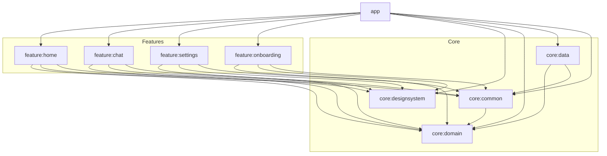

# Orbit - Personal AI Agent Android App

Orbit is a production-quality personal AI agent Android application designed to handle phone tasks via tool-calling (reminders, alarms, notes, notifications summary, app automation). Built with modern Android development standards following Clean Architecture and MVVM.

## Architecture & Modules

Orbit is organized as a multi-module project enforcing strict dependency boundaries:



### Dependency Rules

1. **`core:domain`**: Pure Kotlin module with zero Android framework dependencies. Holds domain models, repository interfaces, and use cases.
2. **`core:common`**: Contains base architecture utilities (`Result`, `AppError`, `UiState`, `BaseViewModel`, `DispatcherProvider`).
3. **`core:designsystem`**: Theme definitions, color tokens, and reusable Material 3 Compose UI components.
4. **`core:data`**: Implements repository interfaces using Room database, DataStore, Retrofit/OkHttp, and WorkManager.
5. **`feature:*`**: Each feature module depends ONLY on `core:domain`, `core:designsystem`, and `core:common`. Feature-to-feature dependencies are strictly forbidden.
6. **`app`**: Application entry point that wires all feature modules and Hilt dependency graphs together.

---

## Data Layer & Persistence Security

- **Room Persistence**: Stores conversations, messages, notes (with FTS4 full-text search), tasks, reminders, and action logs in `orbit_database.db`.
- **Cloud Backup Exclusion**: Configured `data_extraction_rules.xml` and `backup_rules.xml` to explicitly exclude `orbit_database.db` and journal files from unencrypted cloud backups to protect sensitive user conversation history and personal notes.
- **DataStore Repositories**: DataStore Preferences manage `OnboardingRepository`, `VoiceSettingsRepository`, `AppSettingsRepository`, and `AgentSettingsRepository`.
- **Interrupted Recovery**: Automatic startup recovery converts streaming messages interrupted by process death to `Interrupted` status.

---

## Voice & Audio Privacy Notes

- **Zero Audio Storage**: Orbit never records, persists, or uploads raw audio files to external servers. Speech recognition is handled directly via Android's native `SpeechRecognizer` API.
- **On-Device Preference**: On Android 13+ (API 33+), Orbit prefers `SpeechRecognizer.createOnDeviceSpeechRecognizer` for offline speech processing when supported by the device.
- **Privacy Indicator**: Android 12+ (API 31+) displays a system green microphone indicator in the status bar whenever microphone audio is actively being sampled.
- **Languages Supported**: English (`en-IN`), Hindi (`hi-IN`), and Punjabi (`pa-IN`).

---

## Brand & Logo Guidelines

The Orbit brand mark consists of a glowing tilted orbit ring surrounding a gradient core sphere with a revolving satellite dot.

### Master Geometry Specification
- **ViewBox**: 108 x 108
- **Core Sphere**: Center `(54, 54)`, Radius `16dp`, Gradient `Electric Violet (#7C5CFF)` to `Cyan (#22D3EE)`
- **Orbit Ring**: Center `(54, 54)`, Radius X `28dp`, Radius Y `12dp`, Tilt `-25°`, Gradient stroke with fade end
- **Satellite Dot**: Orbiting point at radius `(28dp, 12dp)`

---

## Tech Stack

- **Language:** Kotlin 2.1.10
- **UI Framework:** Jetpack Compose with Material 3
- **Dependency Injection:** Hilt
- **Annotation Processing:** KSP
- **Data & Persistence:** Room, Paging 3, DataStore Preferences
- **Asynchronous & State:** Coroutines, StateFlow, Channel
- **Navigation:** Type-Safe Navigation Compose (`kotlinx.serialization`)
- **Networking:** Retrofit 2, OkHttp 4
- **Background Work:** WorkManager
- **Logging:** Timber

---

## How to Build & Run

### Prerequisites
- JDK 17
- Android SDK (Min SDK 26, Target SDK 35)

### Build Debug APK
```bash
./gradlew assembleDebug
```

### Run Unit Tests
```bash
./gradlew test
```

---

## Roadmap: 15 Steps Checklist

- [x] **Step 1: Project setup and architecture**
- [x] **Step 2: Core Design System & Theme Engine**
- [x] **Step 3: Logo, adaptive launcher icon, and themed icon**
- [x] **Step 4: Live-motion animated splash**
- [x] **Step 5: Onboarding and permissions flow**
- [x] **Step 6: Chat and agent home screen**
- [x] **Step 7: Voice input with live waveform and spoken replies**
- [x] **Step 8: Data layer (Room, DataStore, repositories)**
- [ ] **Step 9: AI Tool-Calling Engine Framework**
- [ ] **Step 10: Reminders & Alarm Tool Implementation**
- [ ] **Step 11: Notes & Memory Management Tooling**
- [ ] **Step 12: Notification Summary & Digest Feature**
- [ ] **Step 13: Feature Settings & Agent Preferences (feature:settings)**
- [ ] **Step 14: End-to-End Integration, Accessibility & 60fps Optimization**
- [ ] **Step 15: Production Hardening, Release Build & Final Verification**
