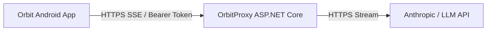

# OrbitProxy - Backend Proxy Service

OrbitProxy is an ASP.NET Core minimal API that acts as a secure provider-neutral backend proxy for the Orbit Android AI agent application. It handles model API authentication, streams events over Server-Sent Events (SSE), and isolates client devices from provider-specific API keys.

## Architecture



## Setup & Running Locally

1. Copy `.env.example` to `.env` or set environment variables:
   ```bash
   LLM_PROVIDER=anthropic
   LLM_API_KEY=your_api_key_here
   LLM_MODEL=claude-3-5-sonnet-20241022
   ORBIT_CLIENT_TOKEN_SECRET=super_secret_orbit_jwt_hmac_signing_key_32_bytes_min
   ```
2. Run the proxy locally on port 5000:
   ```bash
   cd backend/OrbitProxy
   dotnet run
   ```

## Testing with Curl

### 1. Health Check
```bash
curl http://localhost:5000/health
```

### 2. Device Auth Registration
```bash
curl -X POST http://localhost:5000/v1/auth/register \
  -H "Content-Type: application/json" \
  -d '{"installId":"dev-test-device"}'
```

### 3. Stream Chat Request
```bash
curl -N -X POST http://localhost:5000/v1/chat/stream \
  -H "Content-Type: application/json" \
  -H "Authorization: Bearer <TOKEN>" \
  -d '{
    "messages": [
      {
        "role": "user",
        "content": [{"type": "text", "text": "Hello Orbit"}]
      }
    ]
  }'
```

## Security & Deployment Notes

- **Secrets Isolation**: API keys reside solely on the backend proxy server.
- **Rate Limiting**: Configured at 20 requests/minute per client token.
- **Deployment**: Deploy on Azure App Service, Railway, or Fly.io with HTTPS enabled.
