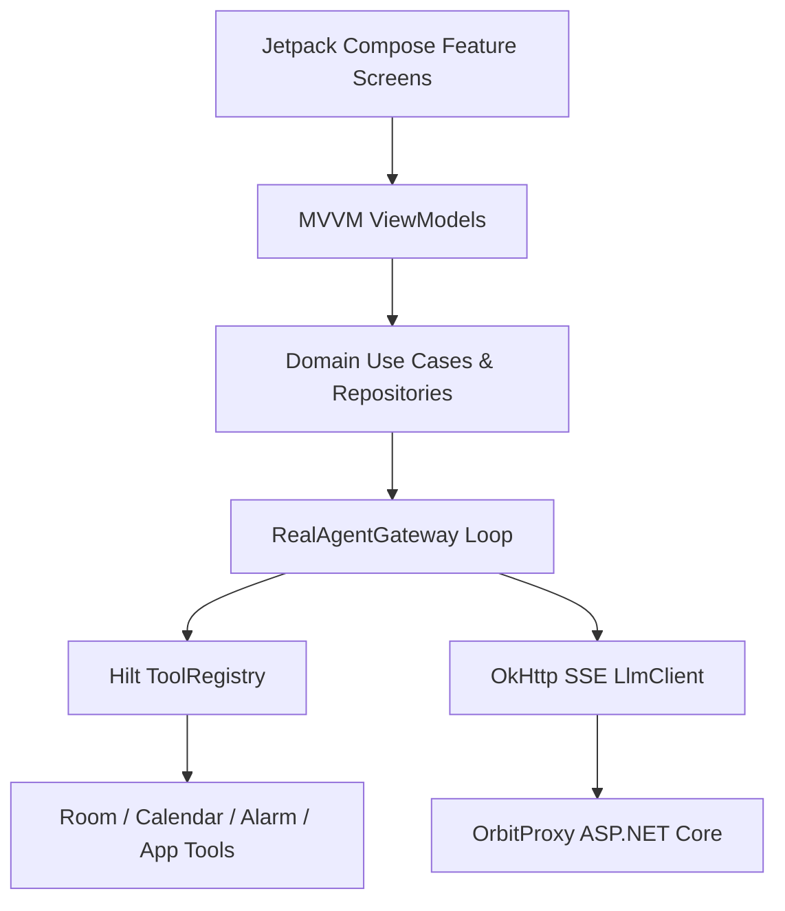

# Orbit - Technical Architecture

Orbit is architected as a modular, reactive native Android application leveraging Clean Architecture, MVVM presentation patterns, Hilt dependency injection, Jetpack Compose UI, Room persistence, and an ASP.NET Core backend proxy.

## Architecture Layers & Data Flow

## Module Structure

- **`core:domain`**: Pure Kotlin JVM module. Holds entities, repository contracts, tool interfaces, and policy evaluators. Zero Android dependencies.
- **`core:common`**: Shared coroutine dispatchers, `Result` monad, `AppError` taxonomy, and `NetworkMonitor`.
- **`core:designsystem`**: Brand colors (`#7C5CFF`, `#22D3EE`), typography, motion tokens, `AgentOrb`, `WaveformView`, `GlassCard`.
- **`core:data`**: Implements repositories, Room database (`OrbitDatabase`), DataStore preferences, and `LlmClientImpl`.
- **`core:tools`**: Android-dependent tool implementations (`SetAlarmTool`, `CreateReminderTool`, `AddCalendarEventTool`, `OpenAppTool`, etc.).
- **`feature:*`**: Modular Compose screens (`chat`, `today`, `activity`, `settings`, `onboarding`, `routines`).
